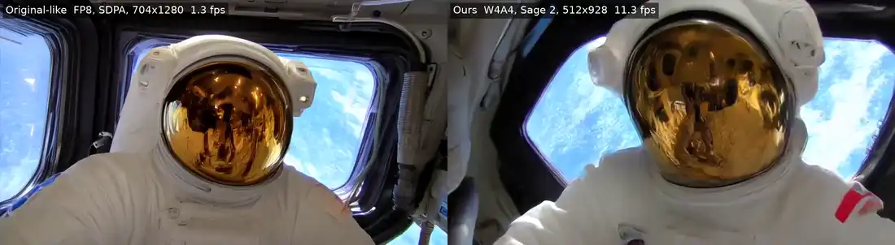

# Wan DiT Lab: real-time 5B video generation on 8 GB

Can a 5B-parameter video model stream video on a laptop RTX 4060 (8 GB VRAM, 16 GB RAM)?

**Yes, close to real time.** The original model needs ≈ 23 GB of VRAM and does not run here. Our runtime runs it in 4.8 GiB of VRAM and 3 GiB of RAM at 11–14 fps (512×928), against 24 fps playback; at the native 704×1280 it runs at 5.4 fps.

Model: [LongLive-2.0-5B](https://github.com/NVlabs/LongLive) (autoregressive video diffusion on Wan 2.2), 2 denoising steps, trained at 704×1280.

## Videos

Left: the configuration closest to the original that fits the machine (FP8 weights, PyTorch SDPA attention, 704×1280), 1.3 fps. Right: where we arrived (W4A4, SageAttention 2, NTK-aware RoPE ×1.1, 512×928), 11.2 fps, 8.6× faster. Same prompts, seed 0. Click a preview for the mp4.

Each video is a chain of voice commands: continue the same scene or cut to a new one. Full prompts: [three-selected-scenes.json](configs/experiments/director-original/three-selected-scenes.json).

**teacup_pour.** A teacup pours water into a glass → stands still → pours red wine → stands still.

[](docs/media/teacup_pour.mp4)

**astronaut.** An astronaut in a space station → an apple flies in → the apple floats → the astronaut reaches and grabs it → holds it.

[](docs/media/astronaut.mp4)

**fox_cabin.** A fox by a cabin → heavy snow → sunset → new scene: the fox by a fireplace at night.

[](docs/media/fox_cabin.mp4)

## Problem

A configuration is a point in a space of factors.

$$
\underbrace{x=(x_1,\ldots,x_k)\in X=X_1\times\cdots\times X_k}_{\text{weights, attention, RoPE, T5, resolution, KV, steps}}
$$

$$
\max_{x\in X}\ \underbrace{Q(x)}_{\text{video quality}}
\quad\text{s.t.}\quad
\underbrace{\mathrm{fps}(x)\ge f_{\rm live}}_{\text{live}},\quad
\underbrace{M_{\rm VRAM}(x)\le 8\ \text{GiB}}_{\text{GPU}},\quad
\underbrace{M_{\rm RAM}(x)\le R}_{\text{host memory}},\quad
\underbrace{B_{\rm write}(x)=0}_{\text{no SSD writes}}
$$

Q is not computed: it is an order on a grid of videos, x ≻ y if x looks better. So we do not search for a global maximum.

$$
\underbrace{N(x)=\{y:\ y\ \text{differs from}\ x\ \text{in exactly one factor}\}}_{\text{neighbours}},\qquad
\underbrace{x^{\ast}:\ \nexists\,y\in N(x^{\ast})\ \text{feasible},\ y\succ x^{\ast}}_{\text{goal: a local optimum}}
$$

<!-- TODO f_live: agree on the number. Option from «Оптимизация»: ρ = T_gen / T_video ≤ 1, i.e. f_live = 24 fps. -->

## Method

There are too many factors to try every combination. The local optimum is found in two stages.

1. **Starting point.** The quality peak is the original model. Drop points that do not fit the machine and take a feasible point next to the peak: x₀ = W4A4, Sage 2, FP8 KV, 704×1280, 5.4 fps.
2. **Descent into the basin.** Each step changes one factor. The result is a row (Δquality, Δfps, Δmemory) and a video grid. Decisions are made on the grid.

| Step from x₀ | fps | Quality by eye | Decision |
| :--- | ---: | :--- | :--- |
| W4A4 → FP8 | 5.4 → 2.2 | not better | rejected |
| fused Sage + RoPE kernel | 5.41 → 5.45 | same | closed |
| T5 BF16 → INT8 | 5.41 → 5.58 | not checked by eye yet | deferred |
| 704×1280 → 512×928 | 5.4 → 11.3 | worse; resolution is the main quality factor | in progress: RoPE profile |

## Meeting the memory constraints

In its original form the model does not fit. Estimate for BF16 at 704×1280:

$$
\underbrace{9.3}_{\text{DiT weights}}+\underbrace{5.1}_{\text{video KV}}+\underbrace{8.6}_{\text{T5}}\approx 23\ \text{GB VRAM}\ \gg 8.
$$

| | Before | After |
| :--- | ---: | ---: |
| VRAM, GiB | ≈ 23 (estimate) | 4.8 |
| RAM, GiB | ≈ 10 (E16) | 3.05 |
| fps, 512×928 | does not run | 14.0–14.6 |
| fps, 704×1280 | does not run | 5.4 |

<!-- TODO: re-measure 512×928 with a fresh run; currently OOM on chunk 3 -->

How:

- W4A4 weights (SVDQuant, Nunchaku kernels): GEMM 1.30 ms vs 4.61 ms in BF16;
- SageAttention 2 and an FP8 KV cache;
- block offloading VRAM ⇄ RAM ⇄ SSD driven by a cost model; the number of prefetch slots is chosen by calibration;
- a Rust runtime over AOTInductor packages: 13.8 → 17.9 fps and RAM 7.1 → 3.2 GiB vs the same path in Python.

## Chapters

1. [Offloading](notes/research/Offloading.md): which resources live where and when they move.
2. [Optimization](notes/research/Оптимизация.md): speed and memory.
3. [Long generation](notes/research/Длительная%20генерация.md): how to continue a video with limited memory.
4. [Scene change](notes/research/Смена%20сцены.md): hybrid control.
5. [RoPE positions](notes/research/Позиции%20RoPE.md): a frame smaller than the trained one.
6. [Experiment log](notes/research/Исследование.md): hypotheses H01–H15, experiments E01–E30.

## Running

One entry point, `bin/wan.exe`; generation is set by a JSON config. Details: [docs/development.md](docs/development.md), [docs/pipeline-config-proposal.md](docs/pipeline-config-proposal.md).

```powershell
.\build.ps1
.\bin\wan.exe --config configs/live.json
.\bin\wan.exe --config configs/offline.json --chains fox_cabin
```
