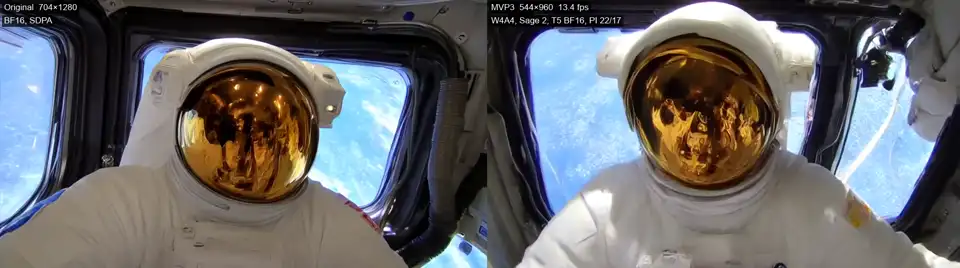
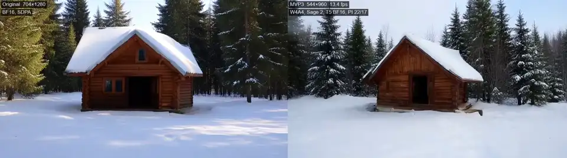
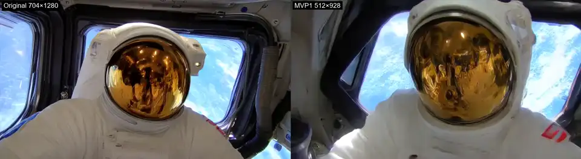
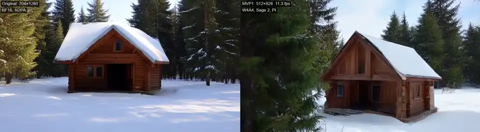
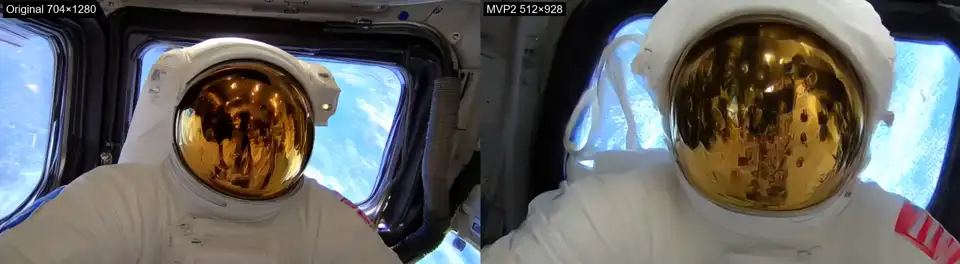
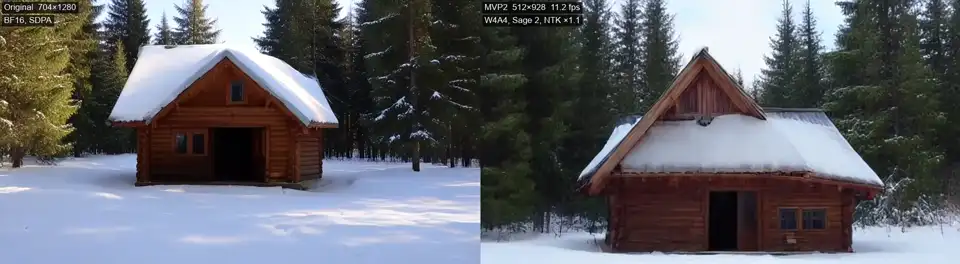

[Русский](docs/README.ru.md)

# Wan DiT Lab: real-time 5B video generation on 8 GB

Can a 5B-parameter video model stream video on a laptop RTX 4060 (8 GB VRAM, 16 GB RAM)?

**Yes.**

$$
\underbrace{M_{\rm VRAM}^{\rm original}\approx 23\ \text{GB}}_{\text{does not fit}}\ \gg\ 8\ \text{GB}\ >\ \underbrace{M_{\rm VRAM}^{\rm ours}=4.8\ \text{GiB}}_{\text{fits}},
\qquad
\underbrace{\mathrm{FPS}^{\rm ours}=11\text{–}14}_{512\times928}
$$

## Videos

Left: the original, 704×1280. Right: the latest version, MVP3, 544×960.

**teacup_pour**
- Prompts: a teacup pours water into a glass → stands still → pours red wine → stands still.

**astronaut**
- Prompts: an astronaut in a space station → an apple flies in → it floats → the astronaut grabs it → holds it.

**small fox**
- Prompts: an empty snowy clearing with a cabin → a small fox runs past the cabin.

<!-- TODO: CLIP score to prompt and CLIP similarity to the left video (needs CLIP weights) -->

## Context

$$
\begin{aligned}
&\mathrm{prompt}\xrightarrow{\mathrm{cfg}}\mathrm{video},&&\text{consider video generation from a prompt in live mode,}\\
&\mathrm{cfg}\in\mathcal C,&&\text{with configurations from the set C,}\\
&\mathrm{FPS}(\mathrm{cfg})=\frac{N_{\rm frames}}{T_{\rm generation}(\mathrm{cfg})}\ge 15,&&\text{Live mode requires a rate of at least 15 frames per second.}\\
&M_{\rm VRAM}(\mathrm{cfg})\le 8\ \text{GB},\quad M_{\rm RAM}(\mathrm{cfg})\le 16\ \text{GB},&&\text{The difficulty is that memory on the NVIDIA GeForce RTX 4060 Laptop graphics card is limited,}\\
&\mathcal L(\mathrm{cfg})=\mathrm{LPIPS}_{\rm align}(\mathrm{cfg})+\bigl(1-\mathrm{DINO}(\mathrm{cfg})\bigr).&&\text{and when video generation is accelerated, the video quality drops, which we measure by the loss.}
\end{aligned}
$$

## Goal

Find the configuration that achieves the smallest loss of video quality at a rate of at least 15 frames per second on the NVIDIA GeForce RTX 4060 Laptop (8 GB of video memory, 16 GB of RAM).

Let us state the optimization problem

$$
\begin{aligned}
\min_{\mathrm{cfg}\in\mathcal C}\quad&\mathcal L(\mathrm{cfg})\\
\text{subject to}\quad&\mathrm{FPS}(\mathrm{cfg})\ge 15,\\
&M_{\rm VRAM}(\mathrm{cfg})\le 8\ \text{GB},\\
&M_{\rm RAM}(\mathrm{cfg})\le 16\ \text{GB}.
\end{aligned}
$$

# Task 1

Build a mathematical model that predicts $\mathrm{FPS}$, memory and $\mathcal L$ from a configuration $\mathrm{cfg}$, so as to discard configurations that violate the constraints even before the experiments.

$$
\mathrm{cfg}=\Bigl(\underbrace{\mathrm{cfg}_{\rm offloading}}_{\text{system loading plan}},\quad \underbrace{\mathrm{cfg}_{\rm input}}_{\text{input}},\quad \underbrace{\mathrm{cfg}_{\rm text\ encoder},\ \underbrace{\mathrm{cfg}_{\rm DiT}}_{\text{transformer block configuration}},\ \mathrm{cfg}_{\rm VAE}}_{\text{video generation}}\Bigr)
$$

| Version       | [Model](docs/research/mvp1/Model.md)                                                                                                                                                                                                                                                                                                                                           | [Quantization](docs/research/mvp2/E30.%20Starting%20point%20W4A4%20704%C3%971280%20and%20postponed%20steps.md)                 | [Compilation](docs/research/MVP1.md#compilation--mvp1)                                                                                                                                                            | [Resolution change](docs/research/mvp1/RoPE-positions.md)                                          | [Offloading](docs/research/mvp1/Offloading.md)                                                                                                                                                                                                                                                                                                      | [Video continuation](docs/research/mvp1/Long-generation.md)                                                                        | [Scene change](docs/research/mvp1/Scene-change.md)                                                                                                                                                                                               |
| :------------ | :----------------------------------------------------------------------------------------------------------------------------------------------------------------------------------------------------------------------------------------------------------------------------------------------------------------------------------------------------------------------------- | :----------------------------------------------------------------------------------------------------------------------------- | :---------------------------------------------------------------------------------------------------------------------------------------------------------------------------------------------------------------- | :------------------------------------------------------------------------------------------------- | :-------------------------------------------------------------------------------------------------------------------------------------------------------------------------------------------------------------------------------------------------------------------------------------------------------------------------------------------------- | :--------------------------------------------------------------------------------------------------------------------------------- | :----------------------------------------------------------------------------------------------------------------------------------------------------------------------------------------------------------------------------------------------- |
| General model | $`\displaystyle \begin{aligned} &\mathrm{prompt}_j\xrightarrow{\mathrm{T5}}\mathrm{ctx}_j,\qquad\qquad\qquad \mathrm{KVtext}_j=\mathrm{KV}^{\rm cross}(\mathrm{ctx}_j),\\ &(\epsilon_{n+1},\mathrm{ctx},\mathrm{KVvid}_n)\xrightarrow{\mathrm{DiT}}(\mathrm{lat}_{n+1},\mathrm{KVvid}_{n+1}),\\ &\mathrm{lat}_{n+1}\xrightarrow{\mathrm{VAE}}\mathrm{frame}_{n+1}. \end{aligned}`$ | $`\displaystyle \mathcal Q:(W_{\rm DiT},W_{\rm T5},\mathrm{KV})\mapsto(\hat W_{\rm DiT},\hat W_{\rm T5},\widehat{\mathrm{KV}})`$ | $`\displaystyle \begin{aligned}&G=(V,E)\\&\mathcal O:\ G\mapsto G'\\&\mathcal C_{\rm compile}:\ G'\xrightarrow{\rm torch.export}G_{\rm FX}\\&G_{\rm FX}\xrightarrow{\rm AOTInductor}\mathrm{package}\end{aligned}`$ | $`\displaystyle \Phi_{\rm pos}:(\mathrm{pos},\theta)\mapsto(\mathrm{pos}^{\prime},\theta^{\prime})`$ | $`\displaystyle \begin{aligned}&\underbrace{G=(V,E)}_{\text{computational graph}},\quad\underbrace{\mathcal R_i\subseteq\mathcal R}_{\text{resources}}\\&\mathrm{plan}^{\star}\in\mathop{\mathrm{arg\,min}}\limits_{\mathrm{plan}}\widehat t_{\rm end}(\mathrm{plan})\\&M_{\rm VRAM}\le B_{\rm VRAM},\quad M_{\rm RAM}\le B_{\rm RAM}\end{aligned}`$ | $`\displaystyle \Phi_{\rm continue}:(\epsilon_{n+1},\mathrm{ctx},\mathrm{KVvid}_n)\mapsto(\mathrm{lat}_{n+1},\mathrm{KVvid}_{n+1})`$ | $`\displaystyle \Phi_{\rm scene}:(\mathrm{KVvid}_0,\mathrm{KVtext}_0,\mathrm{prompt}_1)\mapsto\begin{cases} (\varnothing,\mathrm{KVtext}_1),&\text{new scene},\\ \Phi(\mathrm{KVvid}_0,\mathrm{KVtext}_0),&\text{continuation}. \end{cases}`$ |

## MVP1

| Version                                                      | [Model](docs/research/mvp1/Model.md)                                                                                                                                                                                                                              | [Quantization](docs/research/mvp2/E30.%20Starting%20point%20W4A4%20704%C3%971280%20and%20postponed%20steps.md)                                                                                                                                                                                                                                                                                                                                                                                                                                                                                                                                                                                                                                                       | [Compilation](docs/research/MVP1.md#compilation--mvp1)                                                                                                                                                                                                                                                                                                                                                                                                                                                                                                                                                                                                                                                                                                                                 | [Resolution change](docs/research/mvp1/RoPE-positions.md)                                                                                                                         | [Offloading](docs/research/mvp1/Offloading.md)                                                                                                                                                                                            | [Video continuation](docs/research/mvp1/Long-generation.md)                                                                                                                                 | [Scene change](docs/research/mvp1/Scene-change.md)                                                                                                      |
| :----------------------------------------------------------- | :---------------------------------------------------------------------------------------------------------------------------------------------------------------------------------------------------------------------------------------------------------------- | :------------------------------------------------------------------------------------------------------------------------------------------------------------------------------------------------------------------------------------------------------------------------------------------------------------------------------------------------------------------------------------------------------------------------------------------------------------------------------------------------------------------------------------------------------------------------------------------------------------------------------------------------------------------------------------------------------------------------------------------------------------------- | :------------------------------------------------------------------------------------------------------------------------------------------------------------------------------------------------------------------------------------------------------------------------------------------------------------------------------------------------------------------------------------------------------------------------------------------------------------------------------------------------------------------------------------------------------------------------------------------------------------------------------------------------------------------------------------------------------------------------------------------------------------------------------------- | :-------------------------------------------------------------------------------------------------------------------------------------------------------------------------------- | :---------------------------------------------------------------------------------------------------------------------------------------------------------------------------------------------------------------------------------------- | :------------------------------------------------------------------------------------------------------------------------------------------------------------------------------------------ | :------------------------------------------------------------------------------------------------------------------------------------------------------ |
| [MVP1](docs/research/MVP1.md) [MVP1](configs/mvp1.json) | $`\displaystyle \begin{aligned}&\mathrm{T5}=\mathrm{UMT5\mbox{-}XXL}\\&\mathrm{DiT}:\ \mathrm{Wan}\mapsto\mathrm{LongLive\,2.0\mbox{-}5B\ S2}\\&\mathrm{decoder}:\ \mathrm{Wan\ VAE}\mapsto\mathrm{TAEHV}\end{aligned}`$ [Experiments](docs/research/mvp1/Model.md) | $`\displaystyle \begin{aligned}&\mathcal Q^{(1)}:\\&W_{\rm DiT}^{\rm BF16}\mapsto\widehat W_{\rm DiT}^{\rm W4A4}&&\substack{\mathrm{FPS}:6.28\to11.29\\\mathrm{FP8}\to\mathrm{W4A4},\ 512\times928}\\&W_{\rm T5}^{\rm BF16}\mapsto\widehat W_{\rm T5}^{\rm INT8}&&T_{\rm prompt}:2.86\to1.63\ \mathrm{s}\\&\mathrm{KV}^{\rm BF16}\mapsto\widehat{\mathrm{KV}}^{\rm FP8\ E4M3}&&\substack{M_{\rm KV}:9.819\to4.985\ \mathrm{GiB}\\704\times1280}\end{aligned}`$ FPS and T5 · KV size | $`\displaystyle \begin{aligned}&\mathcal O^{(1)}:\\&\mathrm{Attn}_{\rm self}:\ \mathrm{SDPA}\mapsto\mathrm{Sage\,2}&&\substack{T_{\rm block}:186.8\to77.3\ \mathrm{ms}\\\mathrm{FP8},\ 704\times1280}\\&\mathrm{Attn}_{\rm cross}:\ \mathrm{SDPA}\mapsto\mathrm{Sage\,2}\\&\underbrace{(W_Q,W_K,W_V)\mapsto W_{\rm QKV}}_{\text{self-attention}}\\&\mathrm{FFN}\mapsto\underbrace{\mathrm{GEMM}_1\to\mathrm{GELU}\to\mathrm{Quant}_4}_{\text{fuse}}\to\mathrm{GEMM}_2\\&\mathrm{RoPE}\overset{\rm fuse}{\hookrightarrow}\mathrm{Attn}_{\rm Sage}\end{aligned}`$ [In detail](docs/research/MVP1.md) · Measurement | $`\displaystyle \begin{aligned}&704\times1280\mapsto512\times928\\&\mathrm{PI},\quad t=1\\&N_{\rm steps}=2,\quad\mathrm{shift}=5\end{aligned}`$ [RoPE positions](docs/research/mvp1/RoPE-positions.md) | $`\displaystyle \begin{aligned}&\mathrm{policy}_1=\mathrm{greedy\_ram}\\&B_{\rm VRAM}^{\rm margin}=1.5\ \mathrm{GiB}\\&B_{\rm RAM}^{\rm margin}=0\ \mathrm{GiB}\\&B_{\rm T5}^{\rm first}=1.0\ \mathrm{GiB}\end{aligned}`$ [Offloading](docs/research/mvp1/Offloading.md) | $`\displaystyle \Phi_{\rm continue}^{(1)}:=\left.\Phi_{\rm continue}\right\rvert_{\substack{F_{\rm chunk}=8,\ F_{\rm anch}=8\\F_{\rm win}=32}}`$ [Long generation](docs/research/mvp1/Long-generation.md) | $`\displaystyle \Phi_{\rm scene}^{(1)}:=\left.\Phi_{\rm scene}\right\rvert_{F_{\rm scene\ offset}=8}`$ Mode: not set. [Scene change](docs/research/mvp1/Scene-change.md) |

**MVP1 videos.** Left: the original, 704×1280. Right: MVP1, 512×928.

**teacup_pour**

**astronaut**

**small fox**

# Task 2

MVP1 gave a working generation. Now we start from the 704×1280 reference, take a starting configuration that fits in memory, and change one factor at a time, measuring $\mathrm{FPS}$, memory and $\mathcal L$ for MVP1 and MVP2. The goal is the smallest $\mathcal L$ at $\mathrm{FPS}\ge 15$.

$$
\begin{aligned}
\underbrace{\mathrm{cfg}_0}_{\text{reference for comparison}}&:\quad 704\times1280,\\
\underbrace{\mathcal C_{\rm mem}}_{\text{feasible placement}}&=\{\mathrm{cfg}:M_{\rm VRAM}\le8\ \text{GB},\ M_{\rm RAM}\le16\ \text{GB}\},\\
\underbrace{\mathrm{cfg}_{\rm start}}_{\text{chosen starting point}}&=\mathrm{point\mbox{-}b2}\in\mathcal C_{\rm mem},\\
\underbrace{\mathcal B_{\rm PI},\mathcal B_{\rm NTK}}_{\text{two search regions}}&\subseteq\mathcal C_{\rm mem},\\
\min_{\mathrm{cfg}\in\mathcal B_b}\ \mathcal L(\mathrm{cfg})
&\quad\text{subject to }\mathrm{FPS}(\mathrm{cfg})\ge15,\quad b\in\{\mathrm{PI},\mathrm{NTK}\}.
\end{aligned}
$$

Result 12.11: the loss changes little in both regions; PI chosen by the token grid ratio.

$$
\begin{aligned}
&\mathrm{cfg}_{\rm MVP2}:\quad 544\times960,\quad\underbrace{M_H=\tfrac{22}{17},\quad M_W=\tfrac{40}{30}}_{\text{PI by the grid ratio}},\quad F_{\rm win}=32,\\
\overline{\mathcal L}_1&=0.426,\qquad\underbrace{\mathrm{FPS}=13.44<15}_{\text{constraint not met}}.
\end{aligned}
$$

The nearest point with $\mathrm{FPS}\ge15$: $512\times928$, $\overline{\mathcal L}_1=0.484$. The missing $11.6\%$ of speed is sought in the kernels.

Start and decisions E30 · [Descent 09.11](D:/Experiments/DIT/outputs/res-descent-2026-11-09/REPORT.md) · Latest PI / NTK comparisons

## MVP2

| Version                                                                                                                                          | [Model](docs/research/mvp1/Model.md)                                                                                                                                    | [Quantization](docs/research/mvp2/E30.%20Starting%20point%20W4A4%20704%C3%971280%20and%20postponed%20steps.md)                                                                                                                                                                                                          | [Compilation](docs/research/MVP2.md)                                                                                                                                                                                                                                                                                 | [Resolution change](docs/research/mvp2/RoPE-positions.md)                                                                                                                                                                                                                                                                                                                                                                                | [Offloading](docs/research/mvp2/Offloading-MVP2.md)                                                                                                                                     | [Video continuation](docs/research/mvp2/Long-generation.md)                                                                     | [Scene change](docs/research/mvp1/Scene-change.md)                                                                  |
| :----------------------------------------------------------------------------------------------------------------------------------------------- | :---------------------------------------------------------------------------------------------------------------------------------------------------------------------- | :---------------------------------------------------------------------------------------------------------------------------------------------------------------------------------------------------------------------------------------------------------------------------------------------------------------------- | :------------------------------------------------------------------------------------------------------------------------------------------------------------------------------------------------------------------------------------------------------------------------------------------------------------------- | :--------------------------------------------------------------------------------------------------------------------------------------------------------------------------------------------------------------------------------------------------------------------------------------------------------------------------------------------------------------------------------------------------------------------------------------- | :-------------------------------------------------------------------------------------------------------------------------------------------------------------------------------------- | :------------------------------------------------------------------------------------------------------------------------------ | :------------------------------------------------------------------------------------------------------------------ |
| [MVP2](docs/research/MVP2.md) · NTK $M=1.10$ [mvp2.json](configs/mvp2.json) | $`\displaystyle \begin{aligned}&\mathrm{T5}=\mathrm{UMT5\mbox{-}XXL}\\&\mathrm{DiT}=\mathrm{LongLive\,2.0\mbox{-}5B\ S2}\\&\mathrm{decoder}=\mathrm{TAEHV}\end{aligned}`$ | $`\displaystyle \mathcal Q^{(2)}=\mathcal Q^{(1)}`$ | $`\displaystyle \mathcal O^{(2)}=\mathcal O^{(1)}`$ [In detail](docs/research/MVP2.md) | $`\displaystyle \begin{aligned}&512\times928\mapsto512\times928&&\text{The resolution stays as in MVP1.}\\[14pt]&\text{At the lower resolution PI loses quality, so we try NTK.}\\&\Phi_{\rm pos}^{(2)}:\ \mathrm{PI}\mapsto\mathrm{NTK},\ M_H=1.10&&\text{Compared with PI at 512x928 on seed 0 and 3 scenes.}\\[3pt]&\qquad\Rightarrow\ \overline{\mathcal L}_{\rm NTK}<\overline{\mathcal L}_{\rm PI}&&\text{Better on part of the sample, without a strict criterion.}\end{aligned}`$ [YaRN, App. A.2](https://arxiv.org/html/2309.00071) · [NTK zoom](docs/research/mvp2/NTK-zoom-hypothesis.md) | $`\displaystyle \mathrm{policy}_2=\mathrm{policy}_1`$ [Offloading](docs/research/mvp2/Offloading-MVP2.md) | $`\displaystyle \Phi_{\rm continue}^{(2)}=\Phi_{\rm continue}^{(1)}`$ [Long generation](docs/research/mvp2/Long-generation.md) | $`\displaystyle \Phi_{\rm scene}^{(2)}=\Phi_{\rm scene}^{(1)}`$ [Scene change](docs/research/mvp1/Scene-change.md) |
| [MVP3](docs/research/MVP2.md) · point fixed 12.11 [mvp3.json](configs/mvp3.json) [Working point](configs/candidates/544x960-win32-live.json) | $`\displaystyle \begin{aligned}&\mathrm{T5}=\mathrm{UMT5\mbox{-}XXL}\\&\mathrm{DiT}=\mathrm{LongLive\,2.0\mbox{-}5B\ S2}\\&\mathrm{decoder}=\mathrm{TAEHV}\end{aligned}`$ | $`\displaystyle \begin{aligned}&\text{With INT8 T5 the video follows the prompt worse, so we try BF16.}\\&\mathcal Q^{(3)}:\ \widehat W_{\rm T5}^{\rm INT8}\mapsto W_{\rm T5}^{\rm BF16}&&\text{Compared at 704x1280 on the same prompts.}\\[3pt]&\qquad\Rightarrow\ T_{\rm prompt}:1.63\to2.86\ \mathrm{s},\ \mathrm{FPS}:5.58\to5.41&&\text{Slower, but follows the prompt better.}\\[14pt]&	ext{With atomic LoRA sums two runs of one config differ, so we fix the order.}\&\Sigma_{\rm LoRA}^{\rm W4A4}:\ \mathrm{atomic}\mapsto\mathrm{ordered}&&\text{Two runs of one config are compared bit by bit.}\\[3pt]&\qquad\Rightarrow\ \mathcal L(\mathrm{run}_1,\mathrm{run}_2):\ >0\to0,\ \mathrm{FPS}_{608}:7.96\to7.75&&\text{The runs become identical, at 2% of speed.}\\[14pt]&W_{\rm DiT}^{\rm W4A4},\ \widehat{\mathrm{KV}}^{\rm FP8\ E4M3}&&\text{As in MVP1.}\end{aligned}`$ [E30](docs/research/mvp2/E30.%20Starting%20point%20W4A4%20704%C3%971280%20and%20postponed%20steps.md) | $`\displaystyle \begin{aligned}&	ext{The fused RoPE was never compared with the original, so we try the LongLive RoPE.}\&\mathcal O^{(3)}:\ \mathrm{RoPE}\overset{\rm fuse}{\hookrightarrow}\mathrm{Attn}_{\rm Sage}\mapsto\mathrm{RoPE}_{\rm LongLive}\to\mathrm{Attn}_{\rm Sage}&&\text{Compared at 704x1280.}\\[3pt]&\qquad\Rightarrow\ \mathrm{FPS}:5.41\to5.45&&\text{The fusion gives no speed, and the video diverges like another seed.}\end{aligned}`$ [In detail](docs/research/MVP2.md) | $`\displaystyle \begin{aligned}&	ext{At 512x928 the quality is still low, so we grow the frame.}\&512\times928\mapsto544\times960&&\text{This is the working point.}\\[14pt]&	ext{M for NTK was chosen by eye, so we search M with a strict criterion.}\&\Phi_{\rm pos}^{(3)}:\ \mathrm{NTK}\mapsto\underbrace{M_H=\tfrac{22}{17},\ M_W=\tfrac{40}{30}}_{\text{PI by the token grid ratio}}&&\text{Compared on the resolution ladder and with CMA-ES, on held-out scenes.}\\[3pt]&\qquad\Rightarrow\ M^\star\in[1.2,\,1.3],\quad\underbrace{0.382}_{\rm CMA},\ \underbrace{0.387}_{\rm PI},\ \underbrace{0.436}_{\rm NTK}&&\text{The best M does not grow, and PI is as good without tuning.}\\[3pt]&\qquad\Rightarrow\ \overline{\mathcal L}_1=0.426,\quad\mathrm{FPS}=13.44&&\text{3 seeds, 4 scenes, first chunk.}\end{aligned}`$ [In detail](docs/research/MVP2.md) · Report | $`\displaystyle \begin{aligned}&	ext{The KV cache in RAM slows generation, so we try VRAM.}\&\mathrm{policy}_3:\ \mathrm{greedy\_ram}\mapsto\mathrm{greedy\_vram},\ B_{\rm VRAM}^{\rm margin}:1.5\to0&&\text{Compared at 576x1056 over 12 chunks.}\\[3pt]&\qquad\Rightarrow\ \mathrm{FPS}:9.6\to11.2&&\text{17\% faster.}\end{aligned}`$ [Offloading](docs/research/mvp2/Offloading-MVP2.md) | $`\displaystyle \Phi_{\rm continue}^{(3)}=\Phi_{\rm continue}^{(1)}`$ [Long generation](docs/research/mvp2/Long-generation.md) | $`\displaystyle \Phi_{\rm scene}^{(3)}=\Phi_{\rm scene}^{(1)}`$ [Scene change](docs/research/mvp1/Scene-change.md) |

**MVP2 videos.** Left: the original, 704×1280. Right: MVP2, 512×928.

**teacup_pour**

**astronaut**

**small fox**

**MVP3 videos.** Left: the original, 704×1280. Right: MVP3, 544×960.

**teacup_pour**

**astronaut**

**small fox**

