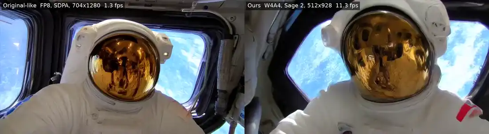
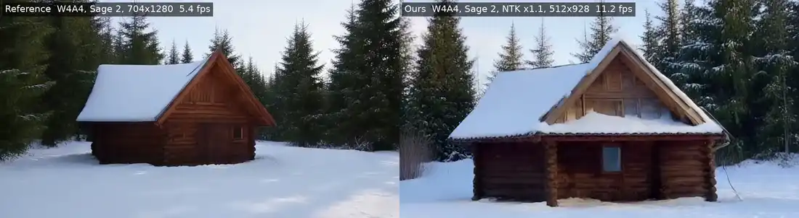

[English](../README.md)

# Wan DiT Lab: генерация видео 5B в реальном времени на 8 ГБ

Может ли видеомодель на 5 миллиардов параметров показывать видео на ноутбуке с RTX 4060 (8 ГБ видеопамяти, 16 ГБ оперативной)?

**Да.**

$$
\underbrace{M_{\rm VRAM}^{\rm original}\approx 23\ \text{ГБ}}_{\text{не помещается}}\ \gg\ 8\ \text{ГБ}\ >\ \underbrace{M_{\rm VRAM}^{\rm ours}=4.8\ \text{ГиБ}}_{\text{помещается}},
\qquad
\underbrace{\mathrm{FPS}^{\rm ours}=11\text{–}14}_{512\times928}
$$

## Видео

**teacup_pour**
- Промпты: чашка наливает воду в стакан → стоит → наливает красное вино → стоит.

**astronaut**
- Промпты: астронавт на космической станции → влетает яблоко → плывёт → астронавт хватает его → держит.

**small fox**
- Промпты: пустая заснеженная поляна с избушкой → маленькая лиса пробегает мимо избушки.

## Контекст

$$
\begin{aligned}
\mathrm{prompt}&\xrightarrow{\mathrm{cfg}}\mathrm{video},&&\text{рассмотрим видеогенерацию по промпту в режиме live,}\\
\mathrm{cfg}&\in\mathcal C,&&\text{с конфигурациями из множества C,}\\
\mathrm{FPS}(\mathrm{cfg})&=\frac{N_{\rm frames}}{T_{\rm generation}(\mathrm{cfg})}\ge 15,&&\text{Режим live требует частоты не ниже 15 кадров в секунду.}\\
M_{\rm VRAM}(\mathrm{cfg})&\le 8\ \text{ГБ},\quad M_{\rm RAM}(\mathrm{cfg})\le 16\ \text{ГБ},&&\text{Трудность в том, что на видеокарте NVIDIA GeForce RTX 4060 Laptop память ограничена,}\\
\mathcal L(\mathrm{cfg})&=\mathrm{LPIPS}_{\rm align}(\mathrm{cfg})+\bigl(1-\mathrm{DINO}(\mathrm{cfg})\bigr).&&\text{а при ускорении видеогенерации падает качество видео, которое измеряем потерей.}
\end{aligned}
$$

## Цель

Найти конфигурацию, на которой достигается наименьшая потеря качества видео при частоте не ниже 15 кадров в секунду на NVIDIA GeForce RTX 4060 Laptop (8 ГБ видеопамяти, 16 ГБ оперативной).

Сформулируем задачу оптимизации

$$
\begin{aligned}
\min_{\mathrm{cfg}\in\mathcal C}\quad&\mathcal L(\mathrm{cfg})\\
\text{при условиях}\quad&\mathrm{FPS}(\mathrm{cfg})\ge 15,\\
&M_{\rm VRAM}(\mathrm{cfg})\le 8\ \text{ГБ},\\
&M_{\rm RAM}(\mathrm{cfg})\le 16\ \text{ГБ}.
\end{aligned}
$$

# Задача 1

Построить математическую модель, которая по конфигурации $\mathrm{cfg}$ предсказывает $\mathrm{FPS}$, память и $\mathcal L$, чтобы ещё до экспериментов отбрасывать конфигурации, нарушающие ограничения.

$$
\mathrm{cfg}=\Bigl(\underbrace{\mathrm{cfg}_{\rm offloading}}_{\text{план загрузки системы}},\quad \underbrace{\mathrm{cfg}_{\rm input}}_{\text{ввод}},\quad \underbrace{\mathrm{cfg}_{\rm text\ encoder},\ \underbrace{\mathrm{cfg}_{\rm DiT}}_{\text{конфигурация трансформерного блока}},\ \mathrm{cfg}_{\rm VAE}}_{\text{видеогенерация}}\Bigr)
$$

| Версия       | Модель                                                                                                                                                                                                                                                                                                                                                                         | Квантизация                                                                                                                          | Компиляция                                                                                                                                                                  | Смена разрешения                                                                                   | Offloading                                                                                                                                                                                                                                                                                                                                        | Продолжение видео                                                                                                                  | Смена сцены                                                                                                                                                                                                                                       |
| :----------- | :----------------------------------------------------------------------------------------------------------------------------------------------------------------------------------------------------------------------------------------------------------------------------------------------------------------------------------------------------------------------------- | :----------------------------------------------------------------------------------------------------------------------------------- | :-------------------------------------------------------------------------------------------------------------------------------------------------------------------------- | :------------------------------------------------------------------------------------------------- | :------------------------------------------------------------------------------------------------------------------------------------------------------------------------------------------------------------------------------------------------------------------------------------------------------------------------------------------------ | :--------------------------------------------------------------------------------------------------------------------------------- | :------------------------------------------------------------------------------------------------------------------------------------------------------------------------------------------------------------------------------------------------ |
| Общая модель | $\displaystyle \begin{aligned} \mathrm{prompt}_j&\xrightarrow{\mathrm{T5}}\mathrm{ctx}_j,\qquad \mathrm{KVtext}_j=\mathrm{KV}^{\rm cross}(\mathrm{ctx}_j),\\ (\epsilon_{n+1},\mathrm{ctx},\mathrm{KVvid}_n)&\xrightarrow{\mathrm{DiT}}(\mathrm{lat}_{n+1},\mathrm{KVvid}_{n+1}),\\ \mathrm{lat}_{n+1}&\xrightarrow{\mathrm{VAE}}\mathrm{frame}_{n+1}. \end{aligned}$ | $\displaystyle \mathcal Q:(W_{\rm DiT},W_{\rm T5},\mathrm{KV})\mapsto(\hat W_{\rm DiT},\hat W_{\rm T5},\widehat{\mathrm{KV}})$ | $\displaystyle \begin{aligned}&G=(V,E)\\&\mathcal O:\ G\mapsto G'\\&\mathcal C_{\rm compile}:\ G'\xrightarrow{\rm torch.export}G_{\rm FX}\\&G_{\rm FX}\xrightarrow{\rm AOTInductor}\mathrm{package}\end{aligned}$ | $\displaystyle \Phi_{\rm pos}:(\mathrm{pos},\theta)\mapsto(\mathrm{pos}^{\prime},\theta^{\prime})$ | $\displaystyle \begin{aligned}&\underbrace{G=(V,E)}_{\text{вычислительный граф}},\quad\underbrace{\mathcal R_i\subseteq\mathcal R}_{\text{ресурсы}}\\&\mathrm{plan}^{\star}\in\operatorname*{arg\,min}_{\mathrm{plan}}\widehat t_{\rm end}(\mathrm{plan})\\&M_{\rm VRAM}\le B_{\rm VRAM},\quad M_{\rm RAM}\le B_{\rm RAM}\end{aligned}$ | $\displaystyle \Phi_{\rm continue}:(\epsilon_{n+1},\mathrm{ctx},\mathrm{KVvid}_n)\mapsto(\mathrm{lat}_{n+1},\mathrm{KVvid}_{n+1})$ | $\displaystyle \Phi_{\rm scene}:(\mathrm{KVvid}_0,\mathrm{KVtext}_0,\mathrm{prompt}_1)\mapsto\begin{cases} (\varnothing,\mathrm{KVtext}_1),&\text{новая сцена},\\ \Phi(\mathrm{KVvid}_0,\mathrm{KVtext}_0),&\text{продолжение}. \end{cases}$ |

## MVP1

| Версия | Модель | Квантизация | Компиляция | Смена разрешения | Offloading | Продолжение видео | Смена сцены |
| :--- | :--- | :--- | :--- | :--- | :--- | :--- | :--- |
| [MVP1](research/MVP1.md) [MVP1](../configs/mvp1.json) | $\displaystyle \begin{aligned}&\mathrm{T5}=\mathrm{UMT5\mbox{-}XXL}\\&\mathrm{DiT}:\ \mathrm{Wan}\mapsto\mathrm{LongLive\,2.0\mbox{-}5B\ S2}\\&\mathrm{decoder}:\ \mathrm{Wan\ VAE}\mapsto\mathrm{TAEHV}\end{aligned}$ [Эксперименты](../notes/research/Модель.md) | $\displaystyle \begin{aligned}&\mathcal Q^{(1)}:\\&W_{\rm DiT}^{\rm BF16}\mapsto\widehat W_{\rm DiT}^{\rm W4A4}&&\substack{\mathrm{FPS}:6.28\to11.29\\\mathrm{FP8}\to\mathrm{W4A4},\ 512\times928}\\&W_{\rm T5}^{\rm BF16}\mapsto\widehat W_{\rm T5}^{\rm INT8}&&T_{\rm prompt}:2.86\to1.63\ \mathrm{s}\\&\mathrm{KV}^{\rm BF16}\mapsto\widehat{\mathrm{KV}}^{\rm FP8\ E4M3}&&\substack{M_{\rm KV}:9.819\to4.985\ \mathrm{GiB}\\704\times1280}\end{aligned}$ [FPS и T5](../notes/research/cards/E30.%20%D0%A1%D1%82%D0%B0%D1%80%D1%82%D0%BE%D0%B2%D0%B0%D1%8F%20%D1%82%D0%BE%D1%87%D0%BA%D0%B0%20W4A4%20704%C3%971280%20%D0%B8%20%D0%BE%D1%82%D0%BB%D0%BE%D0%B6%D0%B5%D0%BD%D0%BD%D1%8B%D0%B5%20%D1%88%D0%B0%D0%B3%D0%B8.md) · [Объём KV](../docs/bf16-native.md) | $\displaystyle \begin{aligned}&\mathcal O^{(1)}:\\&\mathrm{Attn}_{\rm self}:\ \mathrm{SDPA}\mapsto\mathrm{Sage\,2}&&\substack{T_{\rm block}:186.8\to77.3\ \mathrm{ms}\\\mathrm{FP8},\ 704\times1280}\\&\mathrm{Attn}_{\rm cross}:\ \mathrm{SDPA}\mapsto\mathrm{Sage\,2}\\&\underbrace{(W_Q,W_K,W_V)\mapsto W_{\rm QKV}}_{\text{self-attention}}\\&\mathrm{FFN}\mapsto\underbrace{\mathrm{GEMM}_1\to\mathrm{GELU}\to\mathrm{Quant}_4}_{\text{fuse}}\to\mathrm{GEMM}_2\\&\mathrm{RoPE}\overset{\rm fuse}{\hookrightarrow}\mathrm{Attn}_{\rm Sage}\end{aligned}$ [Подробно](research/MVP1.md) · [Замер](../notes/research/cards/E29.%20%D0%92%D0%B5%D1%80%D1%88%D0%B8%D0%BD%D0%B0%20A%E2%80%B2%20%D0%B8%20%D1%81%D0%BF%D1%83%D1%81%D0%BA%20B,%20FP8,%20704%C3%971280.md) | $\displaystyle \begin{aligned}&704\times1280\mapsto512\times928\\&\mathrm{PI},\quad t=1\\&N_{\rm steps}=2,\quad\mathrm{shift}=5\end{aligned}$ [[Позиции RoPE]] | $\displaystyle \begin{aligned}&\mathrm{policy}_1=\mathrm{greedy\_ram}\\&B_{\rm VRAM}^{\rm margin}=1.5\ \mathrm{GiB}\\&B_{\rm RAM}^{\rm margin}=0\ \mathrm{GiB}\\&B_{\rm T5}^{\rm first}=1.0\ \mathrm{GiB}\end{aligned}$ [[Offloading]] | $\displaystyle \Phi_{\rm continue}^{(1)}:=\left.\Phi_{\rm continue}\right\rvert_{\substack{F_{\rm chunk}=8,\ F_{\rm anch}=8\\F_{\rm win}=32}}$ [[Длительная генерация]] | $\displaystyle \Phi_{\rm scene}^{(1)}:=\left.\Phi_{\rm scene}\right\rvert_{F_{\rm scene\ offset}=8}$ Режим: не задан. [[Смена сцены]] |

# Задача 2

В MVP1 собрали рабочую видеогенерацию и выбрали способы ускорения и экономии памяти.

Рассмотрим поиск качества для MVP2: начнём от эталона 704×1280, выберем стартовую конфигурацию в памяти и будем менять по одному фактору, сравнивая потерю качества.

Провести эксперименты, измерив $\mathrm{FPS}$, память и $\mathcal L$ для MVP1 и MVP2, чтобы найти конфигурацию с наименьшей $\mathcal L$ при $\mathrm{FPS}\ge 15$.

$$
\begin{aligned}
\underbrace{\mathrm{cfg}_0}_{\text{эталон для сравнения}}&:\quad 704\times1280,\\
\underbrace{\mathcal C_{\rm mem}}_{\text{допустимое размещение}}&=\{\mathrm{cfg}:M_{\rm VRAM}\le8\ \text{ГБ},\ M_{\rm RAM}\le16\ \text{ГБ}\},\\
\underbrace{\mathrm{cfg}_{\rm start}}_{\text{выбранная стартовая точка}}&=\mathrm{point\mbox{-}b2}\in\mathcal C_{\rm mem},\\
\underbrace{\mathcal B_{\rm PI},\mathcal B_{\rm NTK}}_{\text{две области поиска}}&\subseteq\mathcal C_{\rm mem},\\
\min_{\mathrm{cfg}\in\mathcal B_b}\ \mathcal L(\mathrm{cfg})
&\quad\text{при }\mathrm{FPS}(\mathrm{cfg})\ge15,\quad b\in\{\mathrm{PI},\mathrm{NTK}\}.
\end{aligned}
$$

PI и NTK задают две области поиска; минимум остаётся целью экспериментов.

Итог 12.11: в обеих областях потеря меняется слабо, выбрали PI по отношению сеток токенов. Закрепили точку по сеткам.

$$
\begin{aligned}
\mathrm{cfg}_{\rm MVP2}&:\quad 544\times960,\quad\underbrace{M_H=\tfrac{22}{17},\quad M_W=\tfrac{40}{30}}_{\text{PI по отношению сеток}},\quad F_{\rm win}=32,\\
\overline{\mathcal L}_1&=0.426,\qquad\underbrace{\mathrm{FPS}=13.44<15}_{\text{ограничение не выполнено}}.
\end{aligned}
$$

Ближайшая точка с $\mathrm{FPS}\ge15$: $512\times928$, $\overline{\mathcal L}_1=0.484$. Недостающие $11.6\%$ скорости ищем в ядрах.

[Старт и решения E30](../notes/research/cards/E30.%20Стартовая%20точка%20W4A4%20704×1280%20и%20отложенные%20шаги.md) · [Спуск 09.11](D:/Experiments/DIT/outputs/res-descent-2026-11-09/REPORT.md) · [Последние сравнения PI / NTK](../docs/STATE.md)

## MVP2

| Версия | Модель | Квантизация | Компиляция | Смена разрешения | Offloading | Продолжение видео | Смена сцены |
| :--- | :--- | :--- | :--- | :--- | :--- | :--- | :--- |
| [MVP2](research/MVP2.md) · точка закреплена 12.11 [MVP2](../configs/mvp2.json) [Рабочая точка](../configs/candidates/544x960-win32-live.json) | $\displaystyle \begin{aligned}&\mathrm{T5}=\mathrm{UMT5\mbox{-}XXL}\\&\mathrm{DiT}=\mathrm{LongLive\,2.0\mbox{-}5B\ S2}\\&\mathrm{decoder}=\mathrm{TAEHV}\end{aligned}$ | $\displaystyle \begin{aligned}&\mathcal Q^{(2)}:\\&W_{\rm DiT}^{\rm BF16}\mapsto\widehat W_{\rm DiT}^{\rm W4A4}&&\text{MVP1}\\&W_{\rm T5}^{\rm BF16}\xrightarrow{\rm id}W_{\rm T5}^{\rm BF16}&&\text{INT8 — позже}\\&\mathrm{KV}^{\rm BF16}\mapsto\widehat{\mathrm{KV}}^{\rm FP8\ E4M3}&&\text{MVP1}\end{aligned}$ | $\displaystyle \begin{aligned}&\mathcal O^{(2)}:\quad\mathcal O^{(1)},\ \text{кроме}\\&\mathrm{RoPE}\overset{\rm fuse}{\hookrightarrow}\mathrm{Attn}_{\rm Sage}\ \mapsto\ \mathrm{RoPE}_{\rm LongLive}\to\mathrm{Attn}_{\rm Sage}&&\text{раздельные ядра}\end{aligned}$ [Подробно](research/MVP2.md) | $\displaystyle \begin{aligned}&704\times1280\mapsto544\times960\\&\underbrace{M_H=\tfrac{22}{17},\quad M_W=\tfrac{40}{30}}_{\text{PI по отношению сеток токенов}}\\&\overline{\mathcal L}_1=0.426,\quad\mathrm{FPS}=13.44\\&F_{\rm win}=32\\&N_{\rm steps}=2,\quad\mathrm{shift}=5\\&\text{3 seed, 4 сцены, первый чанк}\end{aligned}$ [Подробно](research/MVP2.md) · [Отчёт](../docs/report-2026-11-11-loss-704-608-for-fable.md) | $\displaystyle \begin{aligned}&\mathrm{policy}_2=\mathrm{greedy\_vram}\\&B_{\rm VRAM}^{\rm margin}=0\ \mathrm{GiB}\end{aligned}$ [[Offloading]] | $\displaystyle \Phi_{\rm continue}^{(2)}=\Phi_{\rm continue}^{(1)}$ [[Длительная генерация]] | $\displaystyle \Phi_{\rm scene}^{(2)}=\Phi_{\rm scene}^{(1)}$ [[Смена сцены]] |
