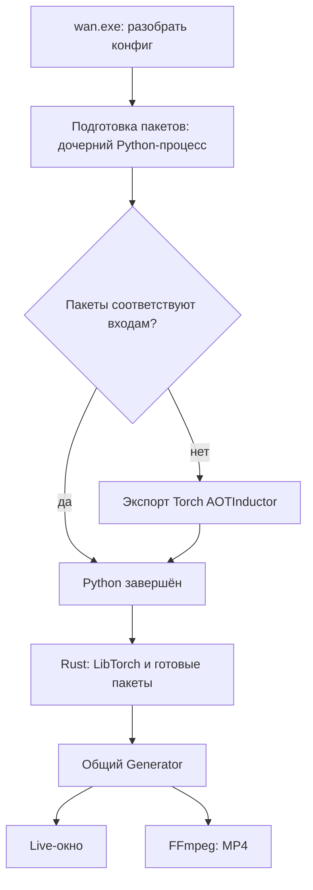

# Pipeline: export → generate

Согласованный формат используется в `configs/live.json` и `configs/offline.json`.
`configs/pipeline.proposed.json` сохраняет тот же пример Live, включая `debug` и `drain`.
Корень JSON — массив из двух компонентов: `export`, затем `generate`.

```powershell
.\build.ps1
.\bin\wan.exe --config configs/live.json
.\bin\wan.exe --config configs/offline.json --chains fox_cabin
.\bin\wan.exe --config configs/live.json --plan
.\bin\wan.exe --config configs/live.json --export-only
```

`--plan` выводит эффективный конфиг после аргументов командной строки, не запуская экспорт или GPU.
`--export-only` выполняет только подготовку пакетов. Аргументы `--prompt`, `--seed`, `--size`, `--chains`,
`--calibration`, `--tier` изменяют тот же разобранный конфиг; именно он передаётся экспортёру и сохраняется
рядом с офлайн-видео. Пути исходных файлов разрешаются относительно корня проекта.

## Границы компонентов

| Компонент | Вход | Результат |
|---|---|---|
| `export` | Архитектура и веса модели, видеоформат, sampling, context, RoPE, kernels | Проверенные `.pt2`, `.safetensors`, таблица RoPE и `live.json` в `output` |
| `generate` | `packages_from: "export"`, источник промптов, seed, offloading и способ вывода | Кадры в Live-окно или MP4 через один `Generator` |



При ошибке подготовки генерация не запускается. Python завершается до загрузки LibTorch в Rust.
В горячем пути нет разбора JSON, хеширования, subprocess или универсального диспетчера компонентов.

## Повторное использование пакетов

`export.rebuild`:

| Значение | Поведение |
|---|---|
| `if_missing_or_changed` | Использовать полные пакеты, соответствующие входам; иначе экспортировать |
| `always` | Экспортировать заново |
| `never` | Использовать только подходящие готовые пакеты; при несовпадении остановиться |

Подпись учитывает рецепт экспорта, содержимое входных весов и токенизатора, используемые исходники
и DLL, версии Python, PyTorch, Triton и safetensors. Манифест также содержит размеры и SHA-256 выходных
пакетов. Проверка выполняется при подготовке и читает исходные файлы; это время запуска, не время чанка.
Изменение промпта, seed, режима или offloading не меняет подпись экспорта.

Незавершённый экспорт оставляет `.exporting`. Частичный экспорт `--only` допускается только при совпадении
ядер и полной подписи прежнего экспорта. Манифест публикуется после проверок всех экспортированных пакетов.

## Параметры и промпты

Все `context.*_frames` и `rope.scene_offset_frames` измеряются в латентных кадрах. `video.fps` относится
к выходному видео. Текущий раннер проверяет поддержанный рецепт LongLive2: UniPC, два шага, shift 5,
контекст 8/32/8, 24 fps. Производные размеры тензоров берутся из архитектуры модели.

`export.rope` задаёт позиции и интерполяцию. `attention: "sage_rope_sm89"` объединяет
подготовку Q/K, RoPE и квантизацию для Sage; отдельный `kernels.rope` при этом запрещён.
Для прежнего `attention: "sage_sm89"` поле `rope` обязательно: `"torch_inductor"` или
экспериментальный `"triton"` из `kernels/rope_triton.py`. Выбор делается для конкретного
блока перед компиляцией, без глобальных подмен и Python в горячем пути Rust.
`rope_dtype` задаёт тип таблицы частот, а не аккумулятора Sage.
[Реализация, точность и проверки объединения](sage-rope-integration.md).
`cross_attention: ["sage_sm89"]` отдельно включает Sage с подготовкой текстовых K/V
один раз при смене промпта; смешивание Sage с SDPA-списком запрещено.
[Контракт и проверки cross-attention](sage-cross-attention.md).
Triton KV-store также входит в пакеты, а Sage/W4A4 вызываются через DLL из `ops/build`.

`generate.prompts` независимо от `generate.mode`:

```json
{"source": "interactive", "initial": "A lone oak tree on a grassy hill sways in the wind"}
```

Без `initial` раннер ждёт первый промпт. Ни в раннере, ни в стартовом скрипте нет скрытой начальной сцены.

```json
{"source": "script", "file": "configs/prompts/demo_chains.json", "chains": ["fox_cabin"]}
```

Сценарий можно показывать в Live или записывать офлайн. Цепочки содержат тексты, переходы и длительности
в чанках; скорость GPU не меняет число кадров. Интерактивный ввод для сценария отключён. `initial`
в сценарном источнике считается ошибкой. Пустой список `chains` выбирает все цепочки файла.
Для интерактивной офлайн-записи `--chunks N` задаёт число чанков (по умолчанию 12).

## Память и вывод

`generate.offloading.calibration`:

| Значение | Поведение |
|---|---|
| `if_needed` | Использовать подходящее сохранённое размещение; иначе измерить |
| `always` | Измерить заново |
| `disabled` | Не измерять; ресурсы с `auto` держать в RAM |

Явные `ram`, `vram`, `disk` сохраняются; изменяемый KV-кэш не размещается на диске.
При `enabled: false` ресурсы остаются в VRAM. Политика повторных измерений не меняет ключ сохранённого
размещения; сами бюджеты памяти и пакеты меняют его.

Для офлайна `generate.output` явно задаёт `directory`, `codec`, `crf`, `pixel_format`.
Путь `outputs/...` разрешается в `~/Documents/Experiments/DIT/outputs/...`. Рядом с видео сохраняется
`run.json`: эффективный конфиг, argv, манифест пакетов, калибровка и сценарий.

## Диагностика: debug и drain

В `configs/live.json`:

```json
"mode": "live",
"debug": "fps",
"drain": { "every": "5s" }
```

`debug` отсутствует или `false`: диагностика выключена. `true` означает все доступные
диагностические функции, `"fps"` включает только замер темпа генерации. Массив имён
позволяет выбрать несколько функций. Сейчас единственная автоматическая метрика — FPS,
поэтому `true`, `"fps"` и `["fps"]` включают один и тот же сбор. В JSON нельзя оставить
одно слово `debug` без значения. Неизвестные имена, повторы и пустой список считаются ошибками.

`drain.every` задаёт период фоновой выгрузки собранных метрик в файл: положительная
длительность `"5s"` / `"10s"` либо `"end"` только при штатном завершении.
`"never"` не поддерживается; для выключения диагностики нужен `debug: false`.
По умолчанию период равен `"5s"`. Периодический режим также выгружает остаток при штатном
завершении. Это обычная буферизованная запись и flush, без fsync на каждый пакет.

Одна ограниченная SPSC-очередь `rtrb` на 256 компактных записей: поток генерации пишет,
фоновый сборщик читает. Память очереди выделена при запуске, блокировок и ожидания места
нет. При переполнении генерация продолжает работу, а счётчик пропусков отмечает
неполноту отчёта. Пула буферов и отдельной очереди на каждую метрику нет.
Сборщик проверяет очередь примерно каждые 100 мс и хранит только суммы, независимо
от периода записи. Поэтому и `"end"` потребляет ограниченную память.
Форматирование, расчёт FPS и запись JSONL выполняет сборщик. В горячем пути Live нет
вывода диагностических строк в консоль; FPS виден в окне.
Результат сохраняется в `~/Documents/Experiments/DIT/outputs/metrics/<time>-<pid>.jsonl`;
путь печатается при запуске. Каждая строка содержит накопительный итог, `dropped`,
`complete` и признак последней записи `final`.

Для FPS достаточно числа реально готовых выходных кадров и прошедшего времени между
выдачами готовых чанков в установившемся режиме. Из них сборщик получает кадры/секунды
и секунды/кадр. Это пропускная способность полного конвейера генерации с декодированием,
а не задержка отдельного кадра или частота показа в окне. Сюда входят задержки подачи
кадров потребителю и смены промптов между завершениями. Не добавляем синхронизацию GPU
на каждый кадр. Первый чанк каждой новой последовательности отмечается как прогрев
и исключается из FPS. Остальные чанки, включая возможную калибровку, входят в итог.
В окне показан темп последнего чанка, в файле — отношение суммарных кадров к суммарному
времени, не среднее арифметическое отдельных значений FPS. Используется реальное число
выходных кадров, в том числе 29 вместо 32 после начального обрезания декодера.

Сам JSON не удаляет инструкции из готового exe. При запуске один раз выбирается
специализация общего `Generator`: `Off` или `Fps`. Внутри цикла нет проверки `debug`,
виртуального вызова наблюдателя, форматирования или файловых операций. Вариант `Off`
имеет пустой наблюдатель, его вызовы удаляются при оптимизации. Функциональные часы
показа кадров в окне остаются независимыми от диагностики.

Обычный `wan.exe` собирается с возможностью FPS; `debug: false` выбирает путь без сбора.
Для полного исключения сборщика и зависимости `rtrb` из бинарника:

```powershell
cargo build --release -p wan --no-default-features --target-dir target/no-metrics
```

Такой бинарник принимает конфиг для просмотра `--plan`, но перед запуском генерации
требует выключенного `debug`. Он не может включить отсутствующий код одним JSON-полем.
`debug-tools` дополнительно включает явные команды проверки эталона и подробный
замер ожидания копий в `bench`. Эти GPU-события исключены из обычной Live/MP4-генерации,
даже в диагностической сборке. Окно при закрытии завершает генератор и сборщик, чтобы
режим `end` успел записать итог. `artifacts/stop_live.ps1` закрывает окно и ждёт завершения;
явный `-Force` оставлен для принудительной остановки, которая не гарантирует запись итога.

## Код и проверки

- `config.rs`: типизированный конфиг и проверка совместимости.
- `pipeline.rs` и `prepare_live.py`: подготовка до загрузки GPU.
- `runtime.rs`: загрузка пакетов, LibTorch и ресурсов CUDA.
- `generation.rs`: общий генератор и проигрывание сценариев.
- `window.rs` / `offline.rs`: вывод кадров; алгоритм чанка у них общий.
- `video.rs`, `rows.rs`, `cache.rs`: вычисления, предзагрузка и владение ресурсами.

Быстрые проверки: `cargo test --workspace --all-features` и
`python -m pytest tests/test_live_pipeline.py tests/test_live_kernels.py tests/test_start_live.py`.
GPU-проверки помечены `ignored` и запускаются отдельно после экспорта пакетов, последовательно:
`cargo test -p wan --features debug-tools -- --ignored --test-threads=1 --nocapture`.
