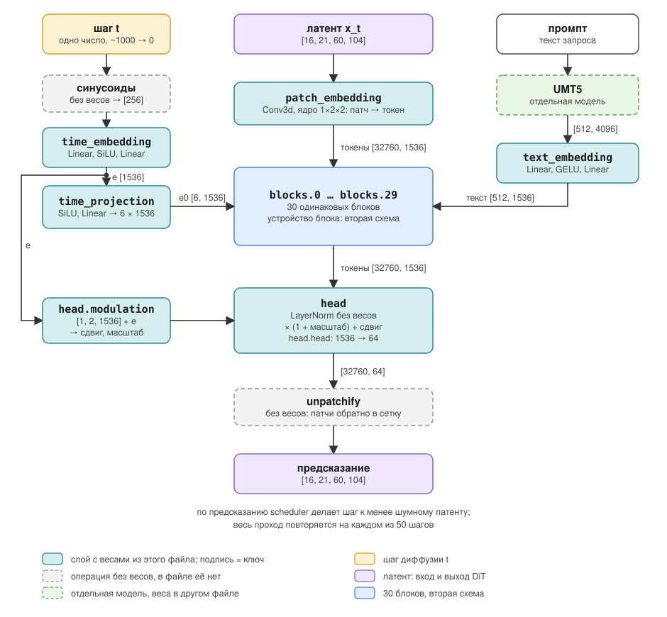
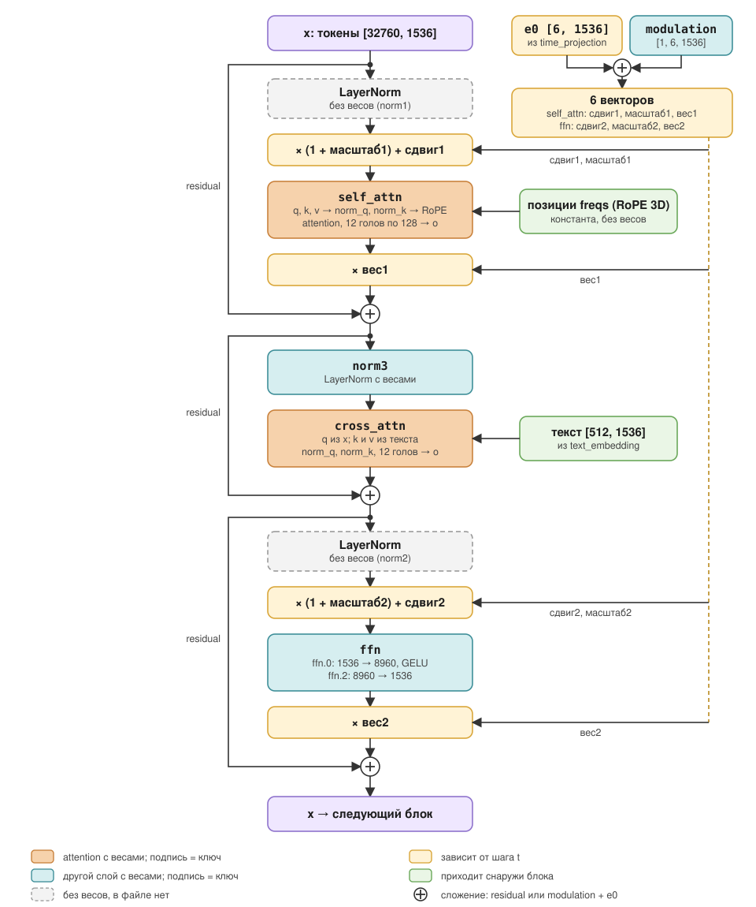

		# Спецификация Wan2.1-T2V-1.3B

## 1. Предсказание до открытия файла (27.09.2026)

Записано по цепочке генерации, до чтения ключей. Не исправлять задним числом: сверка идёт в разделе 2.

| Группа | Предсказание | Уверенность |
| :--- | :--- | :--- |
| Patch embedding | свёртка, ядро 2×2, шаг 2, обучаемое ядро; на входе 16 каналов, патч 2×2×16, плюс ось времени | ось времени: ? |
| Кодирование шага t | t → синусоидальный код 256 → MLP, матрица 1536×256 | остальные слои MLP: ? |
| Шесть векторов модуляции | не знаю | ? |
| Проекция текста | 1536 × emb_dim текста | emb_dim: ? |
| Cross-attention (в блоке) | 1536×1536; уточнение до скрипта: четыре матрицы Wq, Wk, Wv, Wo; 12 голов по 1536/12 = 128, Wo объединяет выходы голов | хранятся ли головы отдельными тензорами: ? |
| MLP (в блоке) | 1536×1536; уточнение до скрипта по `config.json` (`ffn_dim` = 8960): 8960×1536 вверх и 1536×8960 обратно, две матрицы | bias у них: ? |
| Модуляция (в блоке) | AdaLN, та же форма 1536×1536; уже учтена выше, в кодировании t | где живёт, в блоке или вне: ? |
| Self-attention (в блоке) | не записано | ? |
| Нормализации (в блоке) | не записано | ? |
| Head (выход) | не записано | ? |

## 2. Что в файле

Источник: `python -m wan_dit_lab.models.checkpoint` по `diffusion_pytorch_model.safetensors`, ревизия `37ec512` из `configs/upstream.json`. Веса не загружались, формы прочитаны из заголовка файла.

### Итог

| Что | Значение |
| :--- | :--- |
| Всего тензоров | 825 |
| Блоков | 30 (`blocks.0` ... `blocks.29`), по 27 тензоров |
| Тензоров вне блоков | 15 |
| Параметров | 1 418 996 800 |
| dtype | F32 у всех тензоров |

### `config.json`

Гиперпараметры архитектуры: числа, из которых складываются формы всех тензоров ниже. Весов в этом файле нет, только размеры.

| Поле | Значение | Что это |
| :--- | :--- | :--- |
| `dim` | 1536 | Размер вектора одного токена внутри модели. Все подслои читают и пишут векторы этого размера, поэтому 1536 стоит почти в каждой форме. |
| `ffn_dim` | 8960 | Ширина скрытого слоя FFN: токен расширяется с 1536 до 8960 и сжимается обратно. |
| `freq_dim` | 256 | Размер синусоидального кода шага t, который подаётся в `time_embedding`. |
| `num_heads` | 12 | Число голов attention. Одна голова работает с 1536 / 12 = 128 числами токена. |
| `num_layers` | 30 | Число блоков трансформера, `blocks.0` ... `blocks.29`. |
| `in_dim` | 16 | Каналов в латенте видео на входе. Латент выдаёт VAE Wan, модель работает с ним, а не с пикселями. |
| `out_dim` | 16 | Каналов на выходе. Совпадает с `in_dim`: модель выдаёт предсказание той же формы, что латент, и scheduler делает по нему шаг. |
| `text_len` | 512 | Длина текста в токенах. Промпт дополняется нулями до 512, так что в cross-attention k и v всегда 512 токенов. |
| `eps` | 1e-06 | Малое число в знаменателе нормализаций, чтобы не делить на ноль. |

`patch_size` и `text_dim` в `config.json` нет. Их видно по формам весов: `patch_embedding.weight` и `text_embedding.0.weight`.

### Что такое ключ

Ключ это имя тензора в файле весов: путь к слою в модели плюс `weight` или `bias`. У одного Linear два тензора: матрица `weight` и вектор `bias`, слой считает `y = weight · x + bias`. Поэтому `text_embedding.0.weight` и `text_embedding.0.bias` это один слой, а не два одинаковых. Число в имени (`text_embedding.0`, `ffn.2`) это номер слоя внутри `nn.Sequential`. Пропущенные номера (`text_embedding.1`, `ffn.1`) это активации GELU и SiLU: весов у них нет, поэтому в файле их тоже нет. Так же в файле не видны нормализации без параметров и RoPE, хотя в модели они есть.

Порядок прохода: `patch_embedding` превращает латент в токены, токены проходят 30 блоков, `head` возвращает их в форму латента. Параллельно `text_embedding` и `time_*` готовят условия (текст и шаг t), которые читает каждый блок.

### Ключи вне `blocks.*`

Слои, которые работают один раз за проход: до стека блоков готовят вход и условия, после него собирают выход. Всего 25 775 680 параметров, меньше 2% модели.

Это не предобработка видео: пиксели в DiT не попадают. При генерации из текста исходного видео нет вообще, начинают с шума в пространстве латентов. Латент в видео переводит VAE, промпт в векторы переводит UMT5; обе модели отдельные, их веса лежат в других файлах. Как всё это связано, показано на схеме под таблицей.

| Слой                     | Тензоры и формы                                                                    | Что делает и почему без него нельзя                                                                                                                                                                                                    |
| :----------------------- | :--------------------------------------------------------------------------------- | :------------------------------------------------------------------------------------------------------------------------------------------------------------------------------------------------------------------------------------- |
| `patch_embedding`        | `weight [1536, 16, 1, 2, 2]`, `bias [1536]`                                        | Вход. Conv3d режет латент видео (16 каналов) на патчи и превращает каждый в токен размера 1536. Оси ядра: время, высота, ширина. Без него блокам нечего читать: трансформер принимает последовательность векторов, а не сетку.         |
| `text_embedding.0`, `.2` | `0.weight [1536, 4096]`, `0.bias [1536]`, `2.weight [1536, 1536]`, `2.bias [1536]` | Два Linear с GELU между ними. Переводит выход текстового энкодера UMT5 (4096 на токен текста) в размер модели 1536. Без него cross-attention не может читать текст: другой размер и другое пространство.                               |
| `time_embedding.0`, `.2` | `0.weight [1536, 256]`, `0.bias [1536]`, `2.weight [1536, 1536]`, `2.bias [1536]`  | Шаг диффузии t сначала кодируется синусоидами в вектор 256 (`freq_dim`, без весов), затем Linear, SiLU, Linear дают вектор 1536. Без него модель не знает, сколько шума осталось, и не может решить, насколько сильно чистить.         |
| `time_projection.1`      | `weight [9216, 1536]`, `bias [9216]`                                               | SiLU, затем Linear. Из вектора времени делает 9216 = 6 × 1536 чисел, то есть шесть векторов модуляции. Считается один раз и раздаётся всем 30 блокам. Через него шаг t управляет каждым блоком.                                        |
| `head.modulation`        | `[1, 2, 1536]`                                                                     | Два вектора, сдвиг и масштаб, для нормализации перед выходом. Складываются с вектором времени. Последний слой тоже должен знать шаг t.                                                                                                 |
| `head.head`              | `weight [64, 1536]`, `bias [64]`                                                   | Выход. Каждый токен из 1536 переводится в 64 = 16 каналов × 1 × 2 × 2, то есть в значения одного патча латента. Затем unpatchify (без весов) собирает патчи обратно в сетку. Без него на выходе векторы 1536, а scheduler ждёт латент. |



Бирюзовые прямоугольники это ключи из таблицы выше. Шаг t и промпт превращаются в условия `e0` и `текст`, которые читает каждый из 30 блоков. `e` отдельно уходит в `head.modulation`.

### Ключи `blocks.0.*`

`blocks.0` ... `blocks.29` это 30 одинаковых блоков трансформера, через которые по очереди проходят токены видео. Здесь 98% параметров и почти все вычисления. Ниже ключи одного блока, префикс `blocks.0.` опущен. У остальных 29 блоков те же имена и формы. 46 440 704 параметра на блок.

Внутри блока три подслоя по очереди, вокруг каждого residual (`x = x + подслой(x)`):

1. self-attention: токены видео смотрят друг на друга;
2. cross-attention: токены видео читают текст;
3. FFN: каждый токен обрабатывается отдельно.

Перед self-attention и перед FFN стоят LayerNorm без весов, поэтому `norm1` и `norm2` в файле нет. Масштаб и сдвиг им даёт модуляция по t.

| Слой                           | Тензоры и формы                                                                    | Что делает и почему без него нельзя                                                                                                                                                                                                                                                                                                                          |
| :----------------------------- | :--------------------------------------------------------------------------------- | :----------------------------------------------------------------------------------------------------------------------------------------------------------------------------------------------------------------------------------------------------------------------------------------------------------------------------------------------------------- |
| `modulation`                   | `[1, 6, 1536]`                                                                     | Своя поправка блока к шести векторам из `time_projection`: сдвиг, масштаб и вес residual для self-attention и столько же для FFN. Без неё блок работает одинаково на любом шаге шума.                                                                                                                                                                        |
| `self_attn.q`, `.k`, `.v`      | у каждого `weight [1536, 1536]`, `bias [1536]`                                     | Проекции токена в запрос, ключ и значение; 1536 делится на 12 голов по 128. К q и k применяется RoPE (без весов), так attention знает положение токена по времени, высоте и ширине. Self-attention единственное место, где токены видео обмениваются информацией. Без него каждый патч генерировался бы отдельно, и кадр развалился бы на независимые куски. |
| `self_attn.norm_q`, `.norm_k`  | у каждого `weight [1536]`                                                          | RMSNorm на q и k перед attention (QK-norm), только масштаб, без bias. Не даёт произведениям q·k разрастись, иначе softmax вырождается в один токен. Модель обучена с ним, при выводе его нельзя выкинуть.                                                                                                                                                    |
| `self_attn.o`                  | `weight [1536, 1536]`, `bias [1536]`                                               | Смешивает выходы 12 голов обратно в один вектор 1536. Без него головы остаются независимыми кусками и не обмениваются найденным.                                                                                                                                                                                                                             |
| `norm3`                        | `weight [1536]`, `bias [1536]`                                                     | LayerNorm перед cross-attention, единственная нормализация блока с весами. Модуляция по t к ней не применяется. Выравнивает масштаб токенов перед чтением текста.                                                                                                                                                                                            |
| `cross_attn.q`, `.k`, `.v`     | у каждого `weight [1536, 1536]`, `bias [1536]`                                     | q строится из токенов видео, k и v из токенов текста. Так промпт попадает в видео. Без cross-attention модель генерировала бы что-то, не связанное с текстом.                                                                                                                                                                                                |
| `cross_attn.norm_q`, `.norm_k` | у каждого `weight [1536]`                                                          | QK-norm, как в self-attention.                                                                                                                                                                                                                                                                                                                               |
| `cross_attn.o`                 | `weight [1536, 1536]`, `bias [1536]`                                               | Смешивает выходы голов, как `self_attn.o`.                                                                                                                                                                                                                                                                                                                   |
| `ffn.0`, `ffn.2`               | `0.weight [8960, 1536]`, `0.bias [8960]`, `2.weight [1536, 8960]`, `2.bias [1536]` | Расширение 1536 → 8960, GELU (`ffn.1`, без весов), сжатие обратно. Attention собирает информацию от других токенов, FFN перерабатывает её внутри каждого токена. Здесь 59% параметров блока.                                                                                                                                                                 |



Три подслоя идут сверху вниз. Каждый прибавляет свой результат к x через residual, а не заменяет его. Жёлтые прямоугольники зависят от шага t: шесть векторов получаются из `e0` и `modulation` этого блока. Текст входит только в `cross_attn`.

Три разных входа блока, их легко перепутать:

| Что | Откуда | Куда в блоке | Есть ли веса |
| :-- | :-- | :-- | :-- |
| Шаг шума t, то есть `e0` | номер шага диффузии → `time_embedding` → `time_projection`, общий для всех блоков | прибавляется к `modulation` блока, получаются шесть векторов: сдвиг, масштаб и вес для self_attn и для ffn (жёлтые прямоугольники) | `modulation` обучаемая, своя в каждом блоке |
| Позиции `freqs` (RoPE) | таблица частот, считается один раз по формуле | только внутрь `self_attn`, к q и k | нет, это константа |
| Текст `context` | `text_embedding` | только `cross_attn`, как k и v | веса в самом `cross_attn` |

### Генерация целиком

DiT вызывается много раз, по разу на каждый шаг диффузии. Шаг t говорит модели, сколько шума осталось в латенте: в начале латент чистый шум, в конце готовый результат. Одна и та же модель работает на всех шагах, поэтому t подаётся ей на вход.

```
шум [16, 21, 60, 104]
  │
  │  повторить 50 раз, t убывает от ~1000 (только шум) к 0:
  │    предсказание = DiT(латент, t, текст)              ← первая схема
  │    латент = scheduler(латент, предсказание)          ← шаг к менее шумному латенту
  ▼
чистый латент [16, 21, 60, 104]
  │
  ▼  VAE decoder, отдельная модель
видео: 81 кадр × 480 × 832
```

Откуда размеры: VAE сжимает время в 4 раза (81 кадр = первый + 80, латентных кадров 1 + 20 = 21) и пространство в 8 раз (480 / 8 = 60, 832 / 8 = 104). Патч 1×2×2 даёт 21 × 30 × 52 = 32 760 токенов.

Официальные схемы Wan без имён ключей: [общая](https://github.com/Wan-Video/Wan2.1/blob/main/assets/video_dit_arch.jpg) из README и [блок](https://arxiv.org/html/2503.20314v2/dit_block.png), рис. 10 статьи [Wan](https://arxiv.org/abs/2503.20314). На схеме блока в статье нет residual и модуляции.

## 3. Расхождения с предсказанием

Колонки «Предсказал» и «В файле» скопированы из разделов 1 и 2 без толкования. «Итог» (совпало, частично, не совпало, не предсказывал) и «Почему» заполняются вручную. `N` в ключе означает любой блок.

| Группа                    | Предсказал (раздел 1)                                                                                                                      | В файле (раздел 2)                                                                                                                                                                                                      | Итог            | Почему                                                                                                                                                                                                                                                                                                                                                                                                                                       |
| :------------------------ | :----------------------------------------------------------------------------------------------------------------------------------------- | :---------------------------------------------------------------------------------------------------------------------------------------------------------------------------------------------------------------------- | :-------------- | :------------------------------------------------------------------------------------------------------------------------------------------------------------------------------------------------------------------------------------------------------------------------------------------------------------------------------------------------------------------------------------------------------------------------------------------- |
| Patch embedding           | свёртка, ядро 2×2, шаг 2, обучаемое ядро; на входе 16 каналов, патч 2×2×16, плюс ось времени. ? ось времени                                | `patch_embedding.weight [1536, 16, 1, 2, 2]`, `patch_embedding.bias [1536]`                                                                                                                                             | частично        | Пространство угадал: ядро 2×2, шаг 2, 16 каналов, патч 2×2×16 = 64 числа. Время: ядро по времени 1, патч кадры не склеивает. Время уже сжал VAE: 4 кадра видео → 1 латентный кадр, поэтому один токен лежит в одном латентном кадре (4 кадра видео, 16×16 пикселей). Путал форму весов `[1536, 16, 1, 2, 2]` с формой данных.                                                                                                                |
| Кодирование шага t        | t → синусоидальный код 256 → MLP, матрица 1536×256. ? остальные слои MLP                                                                   | `time_embedding.0.weight [1536, 256]`, `time_embedding.0.bias [1536]`, `time_embedding.2.weight [1536, 1536]`, `time_embedding.2.bias [1536]`, `time_projection.1.weight [9216, 1536]`, `time_projection.1.bias [9216]` | частично        | Угадал синусоиды 256 и первый Linear 256 → 1536 (`[1536, 256]`). Не предсказал второй Linear внутри `time_embedding` и `time_projection`: не понимал, зачем они нужны, раз время уже закодировано. Спутал параметры модели и алгоритм.                                                                                                                                                                                                       |
| Шесть векторов модуляции  | не знаю                                                                                                                                    | `blocks.N.modulation [1, 6, 1536]`; вне блоков `time_projection.1.weight [9216, 1536]`                                                                                                                                  | не предсказывал | Не знал, что условие по шагу раскладывают на 6 векторов, и не понимал, что такое модуляция. Теперь: в слоях, которым нужно знать шаг шума (self-attention и FFN; cross-attention без модуляции), после нормализации подмешиваются два вектора, масштаб и сдвиг, а третий, вес вклада, умножает выход перед residual: так якобиан блока остаётся около I и не взрывается. 2 подслоя × 3 вектора = 6, в каждом 1536 чисел, по одному на канал. |
| Проекция текста           | 1536 × emb_dim текста. ? emb_dim                                                                                                           | `text_embedding.0.weight [1536, 4096]`, `text_embedding.0.bias [1536]`, `text_embedding.2.weight [1536, 1536]`, `text_embedding.2.bias [1536]`                                                                          | частично        | emb_dim = 4096: это размер выхода текстового энкодера UMT5, его нужно преобразовать в 1536, чтобы текст подходил видеомодели. Первую матрицу угадал. Не предсказал второй слой `text_embedding.2 [1536, 1536]` и bias: он подгоняет выход эмбеддинга текста под пространство, в котором работает cross-attention видео.                                                                                                                      |
| Cross-attention (в блоке) | 1536×1536; четыре матрицы Wq, Wk, Wv, Wo; 12 голов по 1536/12 = 128, Wo объединяет выходы голов. ? хранятся ли головы отдельными тензорами | `cross_attn.q`, `.k`, `.v`, `.o`: у каждого `weight [1536, 1536]`, `bias [1536]`; `cross_attn.norm_q.weight [1536]`, `cross_attn.norm_k.weight [1536]`                                                                  | частично        | Четыре матрицы 1536×1536 и 12 голов по 128 угадал. Ответ на «?»: головы не хранятся отдельными тензорами. Матрица одна и лежит в памяти одним куском, а во время forward её выход нарезается на 12 голов (`view`), то есть хранится одним куском, а представляется несколькими. Не предсказал bias у q, k, v, o и `norm_q`, `norm_k`.                                                                                                        |
| MLP (в блоке)             | 8960×1536 вверх и 1536×8960 обратно, две матрицы. ? bias у них                                                                             | `ffn.0.weight [8960, 1536]`, `ffn.0.bias [8960]`, `ffn.2.weight [1536, 8960]`, `ffn.2.bias [1536]`                                                                                                                      | совпало         | Формы угадал по `ffn_dim`: 8960×1536 вверх и 1536×8960 обратно. Про bias забыл; ответ на «?»: bias есть у обоих слоёв, `[8960]` и `[1536]`.                                                                                                                                                                                                                                                                                                  |
| Модуляция (в блоке)       | AdaLN, та же форма 1536×1536; уже учтена выше, в кодировании t. ? где живёт, в блоке или вне                                               | в блоке `blocks.N.modulation [1, 6, 1536]`; вне блоков `time_projection.1.weight [9216, 1536]`, `head.modulation [1, 2, 1536]`                                                                                          | частично        | Идею угадал: это AdaLN, шесть векторов подмешиваются в разные компоненты трансформера, чтобы подмешать шаг диффузии. Форму не угадал: ждал матрицу 1536×1536, а в блоке лежит только `modulation [1, 6, 1536]`. Ответ на «?»: живёт в обоих местах. Вне блоков общий `time_projection` считает шесть векторов из шага, в блоке к ним прибавляется своя поправка.                                                                             |
| Self-attention (в блоке)  | не записано                                                                                                                                | `self_attn.q`, `.k`, `.v`, `.o`: у каждого `weight [1536, 1536]`, `bias [1536]`; `self_attn.norm_q.weight [1536]`, `self_attn.norm_k.weight [1536]`                                                                     | не предсказывал | Устроена как cross-attention: четыре матрицы 1536×1536, 12 голов по 128, `norm_q` и `norm_k`. Отличие: в cross-attention k и v берутся из токенов текста, а в self-attention из токенов видео (эмбеддингов патчей латента). |
| Нормализации (в блоке)    | не записано                                                                                                                                | `norm3.weight [1536]`, `norm3.bias [1536]`; `self_attn.norm_q`, `self_attn.norm_k`, `cross_attn.norm_q`, `cross_attn.norm_k`: только `weight [1536]`; ключей `norm1` и `norm2` нет                                      | не предсказывал | В блоке 7 нормализаций: 3 LayerNorm и 4 RMSNorm (`norm_q`, `norm_k` в двух attention). LayerNorm считает среднее и дисперсию по самому токену на каждом проходе и ничего не хранит; обучаются в нём только масштаб и сдвиг. У `norm1` и `norm2` они выключены, вместо них подставляются векторы модуляции от шага t, поэтому этих ключей нет в файле. У `norm3` они постоянные, поэтому есть `weight` и `bias`. Путал с BatchNorm, который копит статистики, и думал, что нормализация делает распределение нормальным: она только убирает неуправляемый масштаб. |
| Head (выход)              | не записано                                                                                                                                | `head.head.weight [64, 1536]`, `head.head.bias [64]`, `head.modulation [1, 2, 1536]`                                                                                                                                    | не предсказывал | Выход должен вернуть токены обратно в латент, а латент потом идёт в автоэнкодер и становится видео. Поэтому `head.head` переводит 1536 в 64 = 2 × 2 × 16: это один патч латента, зеркало `patch_embedding`. Дальше unpatchify без весов раскладывает патчи в сетку. `head.modulation` это два вектора, масштаб и сдвиг от шага t для LayerNorm перед выходом; веса вклада нет, потому что в head нет residual. |
| Всего параметров          | в разделе 1 не записано; по названию модели 1.3B                                                                                           | 1 418 996 800                                                                                                                                                                                                           | не совпало | По названию 1.3B, в файле 1 418 996 800. Моя гипотеза: в названии считают только трансформер. Не подтвердилась: в файле и так лежит только трансформер (UMT5 и VAE в отдельных файлах), а одни 30 блоков дают 1 393 221 120, вне блоков 25 775 680. Ни одна группа весов разницу не объясняет: это название модели, а не точный подсчёт. |

## 4. Чекпойнты блока 0

Отвечать вслух, не глядя в разделы 2 и 3. Вопросы из `Growth Space/Higgsfield/08 Today Plan.md`, блок 0. Блок 0 закрыт, когда все три сданы без подглядывания.

1. По списку ключей блока: сколько в нём нормализаций, у каких из них есть обучаемые параметры, а у каких нет, и почему так.
2. У блока есть параметр формы `[1, 6, dim]`. Шесть чего и почему именно столько?
3. Есть ключи, которые лежат вне `blocks.*`. Назвать каждый и сказать, в какой момент прохода он работает.

| Чекпойнт | После двух попыток 04.10.2026 | Наводящие вопросы |
| :--- | :--- | :--- |
| 1 | LayerNorm названы верно, вместе с тем, откуда у каждой масштаб и сдвиг. Не названы нормализации внутри attention | Что стоит на q и k перед скалярным произведением? Сколько в блоке attention? Сколько нормализаций всего? |
| 2 | Собрано верно, но с опорой на схему | Повторить без схемы: сколько ролей у векторов и в скольких подслоях подмешивается шаг t? |
| 3 | Не отвечал | В модель входят латент, шаг t и промпт. В какой слой первым попадает каждый? Что стоит после 30 блоков? |

Способ повторения: закрыть файл, нарисовать по памяти проход целиком и один блок с формами тензоров, затем сравнить с рисунками раздела 2. Следующая попытка: 05.10.2026, утром, до другой работы.

Попытка 05.10.2026: чекпойнт 2 сдан по памяти. В чекпойнте 1 снова пропущены нормализации внутри attention (на рисунке блока они не выделены отдельно), в чекпойнте 3 не названы `time_projection` и `head.modulation`. Ответы на 1 и 3 показаны, поэтому они не засчитаны. Следующая попытка по 1 и 3: 06.10.2026.

## 5. Допуск сравнения и лицензии

**Допуск.** Блок сравнивается с эталонным `WanAttentionBlock` на одном входе под `torch.autocast("cuda", dtype=torch.float16)`: форма `[1, 32, 1536]`, сетка `(2, 4, 4)`, веса блоков 0-29, три случайных входа на блок. Допуск стандартный `torch.testing.assert_close` для float32-выхода: `rtol=1.3e-6`, `atol=1e-5`. Все 30 блоков проходят. Допуск не подгонялся: на ручной формуле attention (matmul, деление, softmax) блок расходился на 1e-3 относительно, и причиной было округление оценок до FP16; замена на `scaled_dot_product_attention` вернула совпадение. Таблица углов RoPE должна считаться в float64, как у эталона: с float32 расходилось 43% элементов.

**Лицензии.** Веса и `LICENSE.txt` Wan2.1-T2V-1.3B: Apache 2.0. `reference/Causal-Forcing`: Apache 2.0 (файл `LICENSE` в корне). Код `wan_block/wan` в `reference/INT8-DiT` принадлежит Alibaba Wan Team (шапка файлов), это копия из учебного задания. Код проекта не копирует исходники эталона: он импортируется только в `tests/` и `benchmarks/` для сравнения, а `src/wan_dit_lab/` написан заново. Не проверено: лицензия самого учебного задания INT8-DiT; до публикации репозитория не коммитить `reference/`.
